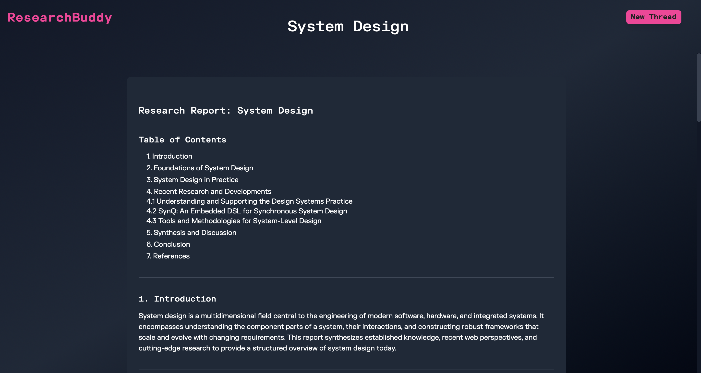
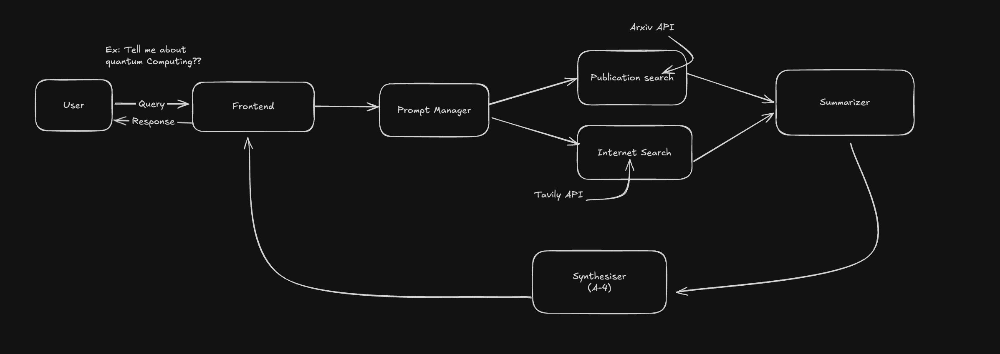

# ResearchBuddy

An AI-powered multi-agent research assistant that automates deep literature reviews and report generation using language models and orchestration.

## User Interface



## Features

- **Multi-Agent Architecture**: Coordinated agents for internet search, academic publication retrieval, summarization, and report generation
- **Advanced LLM Integration**: Leverages OpenAI GPT-4 for intelligent summarization and natural language report writing
- **Academic Search**: Integrates with Semantic Scholar and arXiv APIs for comprehensive literature review
- **Web Search**: Uses Tavily API for real-time web information gathering
- **PDF Report Generation**: Automatically generates professional research reports in PDF format
- **Modern Web Interface**: Clean, responsive React frontend built with Vite
- **RESTful API**: Flask-based backend with CORS support for seamless frontend integration

## Architecture Diagram



## Tech Stack

### Backend
- Python 3.11+
- LangGraph
- LangChain
- OpenAI GPT-4 
- Flask
- FPDF

### Frontend
- React 18 
- Vite 

### APIs & Services
- Semantic Scholar API 
- arXiv API 
- Tavily API 

## Prerequisites

- Python 3.11 or higher
- Node.js 16 or higher
- npm or yarn
- OpenAI API key
- Tavily API key (optional, for web search)
- Semantic Scholar API key (optional, for academic search)

## Installation

### 1. Clone the Repository
```bash
git clone https://github.com/yourusername/ResearchBuddy.git
cd ResearchBuddy
```

### 2. Backend Setup
```bash
# Create virtual environment
python -m venv .venv
source .venv/bin/activate  # On Windows: .venv\Scripts\activate

# Install dependencies
pip install -r requirements.txt

# Set up environment variables
cp .env.example .env
# Edit .env with your API keys
```

### 3. Frontend Setup
```bash
cd frontend
npm install
```

## 🔧 Configuration

Create a `.env` file in the backend directory with the following variables:

```env
OPENAI_API_KEY=your_openai_api_key_here
TAVILY_API_KEY=your_tavily_api_key_here
SEMANTIC_SCHOLAR_API_KEY=your_semantic_scholar_api_key_here
```

## Usage

### 1. Start the Backend
```bash
cd backend
python app.py
```
The API will be available at `http://localhost:8000`

### 2. Start the Frontend
```bash
cd frontend
npm run dev
```
The frontend will be available at `http://localhost:5173`

### 3. Using the Application
1. Open your browser and navigate to `http://localhost:5173`
2. Enter your research query in the input field
3. Click "Generate Report" to start the research process
4. Wait for the agents to complete their tasks
5. Download the generated PDF report

## Project Structure

```
ResearchBuddy/
├── backend/
│   ├── agents/                 # Multi-agent system
│   │   ├── coordinator.py      # Workflow coordinator
│   │   ├── internet_search.py  # Web search agent
│   │   ├── publication_search.py # Academic search agent
│   │   ├── summarizer.py       # Content summarization agent
│   │   └── report_generator.py # Report generation agent
│   ├── api_clients/            # External API integrations
│   │   ├── tavily.py          # Web search API client
│   │   ├── semantic_scholar.py # Academic search API client
│   │   └── arxiv.py           # arXiv API client
│   ├── workflows/              # LangGraph workflows
│   │   └── research_workflow.py # Main research workflow
│   ├── app.py                 # Flask application
│   └── requirements.txt       # Python dependencies
├── frontend/
│   ├── src/
│   │   ├── components/        # React components
│   │   ├── App.jsx           # Main application component
│   │   └── main.jsx          # Application entry point
│   ├── package.json          # Node.js dependencies
│   └── vite.config.js        # Vite configuration
├── .env.example              # Environment variables template
└── README.md                 # This file
```

## Workflow

```
Flask POST /api/research ──► Redis queue ──► rq worker
                                               │
           START ─► planner ─Send×N─► execute_subtask (parallel) ─► synthesizer ─► END
                                          │
                                     ToolRouter (retry + fallback) ─► 13 tools
```

1. **Queue**: `POST /api/research` puts the job on a Redis queue (RQ) and returns a `job_id`. Workers (`rq worker research`) run it, and the UI polls `GET /api/research/<job_id>` for progress. If Redis is unreachable, the API runs the job inline instead.
2. **Plan** (`workflows/research_workflow.py`): an LLM splits the query into up to `MAX_SUBTASKS` (5) subtasks, each tagged with a tool category. Invalid plans fall back to a default web + academic plan.
3. **Execute in parallel**: LangGraph's `Send` API starts one `execute_subtask` node per subtask in the same step (`MAX_CONCURRENCY`, default 5). Results merge through an `operator.add` reducer.
4. **Synthesize**: sources are de-duplicated and numbered. The LLM writes the report citing `[n]`, and the References list is generated from the real tool results, so links are never invented by the model.

### Tool layer (`backend/tools/`)

Every tool implements `Tool.run(input) -> list[Source]` and is registered in a `ToolRegistry`. Adding an integration means writing one class and adding it to `DEFAULT_TOOLS`.

| Category | Tools (fallback order) |
|---|---|
| `web_search` | tavily → wikipedia → duckduckgo |
| `academic_search` | semantic_scholar → arxiv → openalex → crossref → pubmed |
| `code_search` | github |
| `discussion_search` | hackernews |
| `code_execution` | python_exec (subprocess, timeout, no env secrets; **not** a security sandbox, so disable with `CODE_EXECUTION_ENABLED=0`) |
| `document_parsing` | pdf_reader → web_page_reader |

`ToolRouter` gives each tool up to 3 attempts with exponential backoff (1s, 2s, capped at 8s, plus jitter) and a per-call timeout. Non-retryable errors (4xx, bad input) and empty results skip straight to the next tool in the category. Every attempt is recorded and shown at the end of the report.

### Running with the queue

```bash
docker compose up --build          # redis + backend + worker
# or locally:
redis-server &
cd backend && rq worker research --worker-class rq.worker.SimpleWorker &   # SimpleWorker avoids fork issues on macOS
python app.py
```

### Tests

```bash
cd backend && pip install -r requirements-dev.txt && pytest tests/ -q
```

## API Endpoints

### POST `/api/research`
Body `{"query": "Recent advances in quantum computing"}`. Returns `202 {"job_id", "status_url"}`. With `?sync=1`, or when Redis is down, it returns the result directly (`200`).

### GET `/api/research/<job_id>`
Returns `{"status": "queued|started|finished|failed", "stage", "progress", "result"}`. `result` contains `report`, `subtasks`, `sources` and `tool_log`.

### GET `/api/tools`
Lists the registered tools, their categories, and whether each is available (for example, whether its API key is set).
